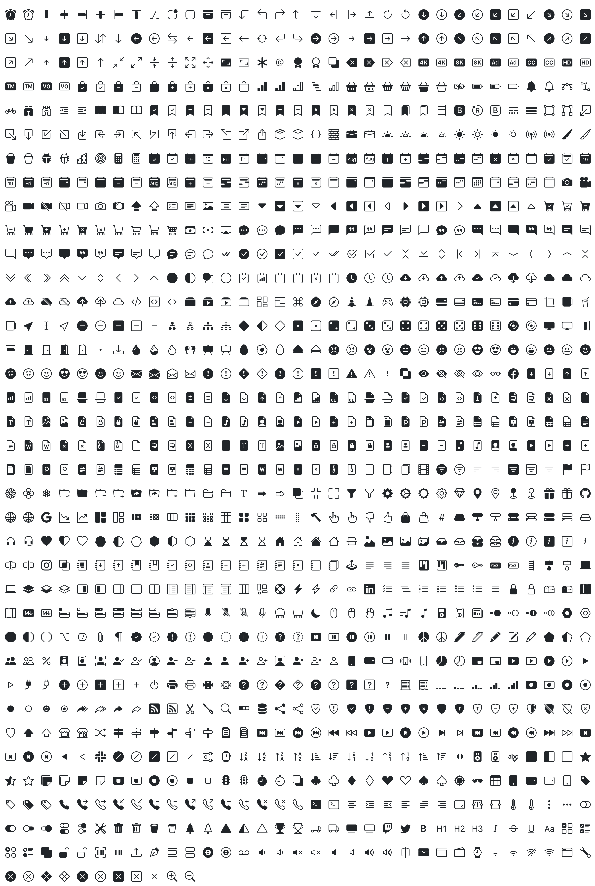

<p align="center">
  <a href="https://getbootstrap.com/">
    
  </a>
</p>

<h3 align="center">Bootstrap Icons</h3>

<p align="center">
  Official open source SVG icon library for Bootstrap with over 2,000 icons.
  <br>
  <a href="https://icons.getbootstrap.com/"><strong>Explore Bootstrap Icons »</strong></a>
  <br>
  <br>
  <a href="https://getbootstrap.com/">Bootstrap</a>
  ·
  <a href="https://blog.getbootstrap.com/">Blog</a>
  <br>
</p>

[](https://icons.getbootstrap.com/)

## Install

The published package includes individual SVG files, the combined SVG sprite, icon fonts, CSS, and Sass.

```shell
npm i bootstrap-icons
```

For those [using Packagist](https://packagist.org/packages/twbs/bootstrap-icons), Bootstrap Icons are also available via Composer:

```shell
composer require twbs/bootstrap-icons
```

You can also [download the latest release archive](https://github.com/twbs/icons/releases/latest/).

### CDN

For the icon font, include the versioned jsDelivr stylesheet in your document head or import it from your stylesheet:

```html
<link rel="stylesheet" href="https://cdn.jsdelivr.net/npm/bootstrap-icons@1.13.2/font/bootstrap-icons.min.css">
```

```css
@import url("https://cdn.jsdelivr.net/npm/bootstrap-icons@1.13.2/font/bootstrap-icons.min.css");
```

## Usage

Bootstrap Icons are SVGs, so they scale quickly and easily and can be styled with CSS. While they're built for Bootstrap, they'll work in any project.

### Embedded SVG

Embed an icon's SVG directly in your HTML. A width and height of `1em` lets the icon scale with the surrounding text.

```html
<svg xmlns="http://www.w3.org/2000/svg" width="1em" height="1em" fill="currentColor" class="bi bi-heart-fill" viewBox="0 0 16 16" aria-hidden="true">
  <path d="M4 1c2 0 3 1.5 4 3 1-1.5 2-3 4-3 2.5 0 4 2 4 4.5 0 3-2.5 5.5-8 9.5C2.5 11 0 8.5 0 5.5 0 3 1.5 1 4 1"/>
</svg>
```

### External image

Copy an SVG into your project and reference it like any other image. Use useful alt text when the image conveys meaning and an empty `alt` when it is decorative.

```html

```

### SVG sprite

The package includes `bootstrap-icons.svg`. Copy it to your own origin and use an icon filename as the fragment identifier. Cross-origin external sprites are restricted by some browsers, so serve the sprite with your application.

```html
<svg class="bi" width="32" height="32" fill="currentColor" aria-hidden="true">
  <use href="/bootstrap-icons.svg#toggles"></use>
</svg>
```

See the [complete sprite guide](https://icons.getbootstrap.com/sprite/) for local and external examples.

### Icon font

Include the icon font stylesheet, then combine the base `bi` class with an icon class based on its filename. Font icons inherit the current text size and color.

```html
<i class="bi bi-alarm" aria-hidden="true"></i>
```

When your Sass compiler cannot resolve the package's relative font URLs, set the font directory before importing the source:

```scss
$bootstrap-icons-font-dir: "bootstrap-icons/font/fonts";
@import "bootstrap-icons/font/bootstrap-icons";
```

See the [icon font guide](https://icons.getbootstrap.com/font/) for class examples and the generated font stylesheet.

### Sizing and color

Embedded SVGs and the icon font use `currentColor`. Set `color` directly and set `font-size` when the icon dimensions are `1em`.

```css
.feature-icon {
  color: cornflowerblue;
  font-size: 2rem;
}
```

### Accessibility

Hide purely decorative icons from assistive technology with `aria-hidden="true"`. Meaningful standalone images need an appropriate text alternative. For icon-only controls, put the accessible name on the control—not on its decorative child icon.

```html
<button type="button" aria-label="Mute">
  <svg class="bi" aria-hidden="true">
    <use href="/bootstrap-icons.svg#volume-mute-fill"></use>
  </svg>
</button>
```

Prefer visible text when possible. A visible label or a `visually-hidden` label stays available to screen readers and supports users who may not recognize an icon.

### Use in CSS

SVG data URLs work in CSS, but URL-sensitive characters must be escaped—for example, `#` becomes `%23`. Keep the `viewBox` when resizing with `background-size`, and include the SVG namespace.

```css
.icon-example {
  width: 1rem;
  height: 1rem;
  background-image: url("data:image/svg+xml,<svg viewBox='0 0 16 16' fill='%23333' xmlns='http://www.w3.org/2000/svg'>…</svg>");
  background-repeat: no-repeat;
  background-size: 1rem 1rem;
}
```

## Figma

The official Bootstrap Icons community file makes the icon set [available in Figma](https://www.figma.com/community/file/1042482994486402696/Bootstrap-Icons) for design work.

## Releases and resources

- [Browse and search every icon](https://icons.getbootstrap.com/)
- [Detailed installation and usage guide](https://icons.getbootstrap.com/usage/)
- [SVG sprite guide](https://icons.getbootstrap.com/sprite/)
- [Icon font guide](https://icons.getbootstrap.com/font/)
- [Release notes and downloads](https://github.com/twbs/icons/releases)
- [Package on npm](https://www.npmjs.com/package/bootstrap-icons)

## Development

[](https://github.com/twbs/icons/actions/workflows/test.yml?query=workflow%3ATests+branch%3Amain)
[](https://www.npmjs.com/package/bootstrap-icons)

Clone the repo, install the root and Astro dependencies, and start the docs
server locally.

```shell
git clone https://github.com/twbs/icons/
cd icons
npm ci
npm ci --prefix astro
npm start
```

Then open `http://localhost:4321` in your browser.

### npm scripts

Here are some key scripts you'll use during development. Be sure to look to our `package.json` or `npm run` output for a complete list of scripts.

| Script       | Description                                                                   |
| ------------ | ----------------------------------------------------------------------------- |
| `start`      | Alias for running `docs-serve`                                                |
| `docs-serve` | Starts the local Astro development server                                     |
| `docs-build` | Builds the production documentation site                                      |
| `docs-test`  | Checks, builds, and validates the documentation site                          |
| `pages`      | Generates permalink pages for each icon with template Markdown                |
| `icons`      | Processes and optimizes SVGs in `icons` directory, generates fonts and sprite |

## Adding SVGs

Icons are typically only added by @mdo, but exceptions can be made. New glyphs are designed in Figma first on a 16x16px grid, then exported as flattened SVGs with `fill` (no stroke). Once a new SVG icon has been added to the `icons` directory, we use an npm script to:

1. Optimize our SVGs with SVGO.
2. Modify the SVGs source code, removing all attributes before setting new attributes and values in our preferred order.

Use `npm run icons` to run the script, run `npm run pages` to build permalink pages, complete those pages, and, finally, commit the results in a new branch for updating.

**Warning**: Please exclude any auto-generated files, like `font/**` and `bootstrap-icons.svg` from your branch because they cause conflicts, and we generally update the dist files before a release.

## Unity Stylesheets Support (USS)
Unity Stylesheet support requires utilizing True-Type Fonts (.TTF) and hacky variable overwrites with custom extension logic to replace identifiers dynamically with corresponding font glyphs. Through manual binding, the process can be controlled and managed intelligently and minimizing memory consumption through intelligent utilization. A sample extender has been included below for convenience. Utilizing explicitly managed UXML elements, also included below, the functionality can be extended to automatic construction, replacement, and lifecycle management. 

```C#
	public static class IconGlyphExtensions
	{
		private const string IconClass = "bi";

		// Matches --bi-glyph in the generated USS (decimal codepoint, e.g. --bi-glyph: 61697;)
		private static readonly CustomStyleProperty<int> s_BiGlyphProperty = new("--bi-glyph");

		/// <summary>
		/// One-shot read of --bi-glyph. Only has a value once the element is attached and its styles have resolved.
		/// </summary>
		public static bool SyncGlyphFromStyle(this TextElement element)
			=> TryApply(element, element.customStyle);

		/// <summary>
		/// Keeps the text in sync whenever the element's custom style re-resolves (class swaps, re-attach, etc.).
		/// </summary>
		public static void BindGlyph(this TextElement element)
		{
			// Unregister first so calling this twice never double-binds
			element.UnregisterCallback<CustomStyleResolvedEvent>(OnCustomStyleResolved);
			element.RegisterCallback<CustomStyleResolvedEvent>(OnCustomStyleResolved);
			element.SyncGlyphFromStyle(); // covers elements that are already styled
		}

		/// <summary>
		/// Binds every icon label (class "bi") under root, root included. Call after cloning a UXML tree.
		/// </summary>
		public static void BindGlyphs(this VisualElement root)
		{
			if (root is TextElement self && self.ClassListContains(IconClass))
				self.BindGlyph();

			root.Query<TextElement>(className: IconClass).ForEach(e => e.BindGlyph());
		}

		private static void OnCustomStyleResolved(CustomStyleResolvedEvent evt)
		{
			if (evt.target is TextElement element)
				TryApply(element, evt.customStyle);
		}

		private static bool TryApply(TextElement element, ICustomStyle style)
		{
			if (!style.TryGetValue(s_BiGlyphProperty, out var codePoint)) return false;

			// ConvertFromUtf32 throws on out-of-range values and lone surrogates
			if (codePoint < 0 || codePoint > 0x10FFFF || (codePoint >= 0xD800 && codePoint <= 0xDFFF)) return false;

			element.text = char.ConvertFromUtf32(codePoint);
			return true;
		}
	}
#if UNITY_2023_2_OR_NEWER
	[UxmlElement(nameof(Glyph)), ExecuteAlways]
#endif
  //  It is important to note that the class name Glyph conflicts with an existing VisualElement dependent class of the same name and namespace structuring does not resolve it in code. Using Glyph as the class name (but not the element name under 2023.2+) produces duplication, casting, and serialization errors without obvious trace indicators inside of Unity.
	public partial class IconGlyph : Label
	{
#if !UNITY_2023_2_OR_NEWER
        public new class UxmlFactory : UxmlFactory<IconGlyph> { }
#endif

		public const string BaseClass = "bi";

		private string _icon;

		public IconGlyph() : base()
		{
			AddToClassList(BaseClass);
			this.BindGlyph(); // from THC.Icons.Extensions; add the using if it's in another namespace
		}

		public IconGlyph(string name) : this() => SetIcon(name);

		/// <summary>Swaps the bi-* class; the style re-resolves and the bound callback updates the text.</summary>
		public void SetIcon(string name)
		{
			if (_icon != null) RemoveFromClassList($"bi-{_icon}");

			_icon = name;

			if (string.IsNullOrEmpty(name))
				text = string.Empty;
			else
				AddToClassList($"bi-{name}");
		}
	}
```

## Publishing

Documentation is published automatically when a new Git tag is published. See our [GitHub Actions](https://github.com/twbs/icons/tree/main/.github/workflows) and [`package.json`](https://github.com/twbs/icons/blob/main/package.json) for more information.

## License

[MIT](LICENSE)

## Author

[@mdo](https://github.com/mdo)
